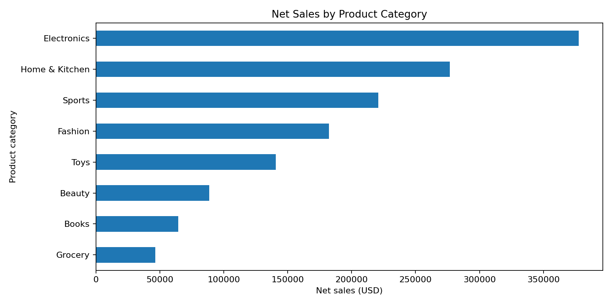
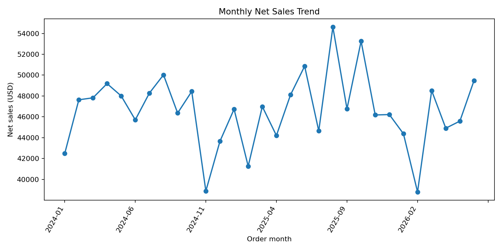
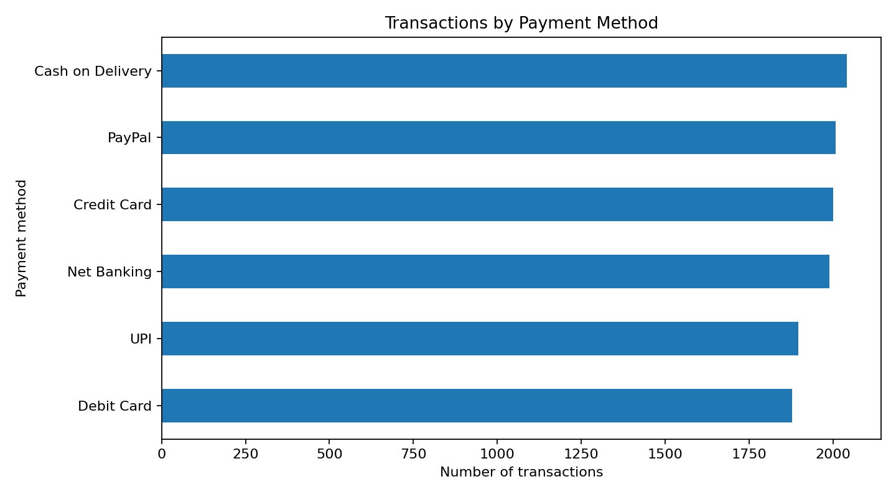
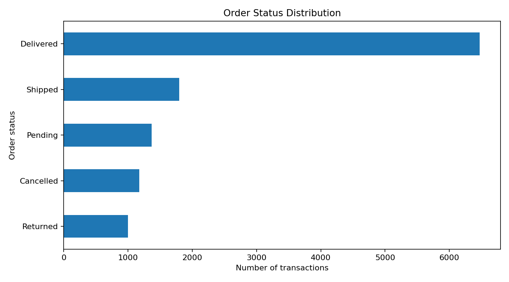
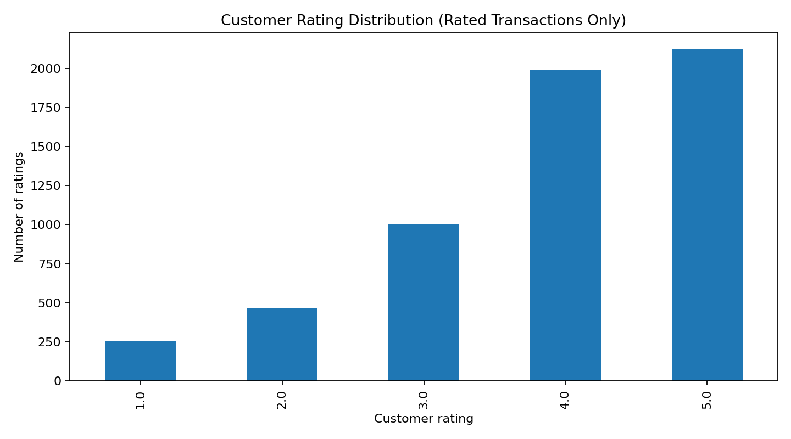
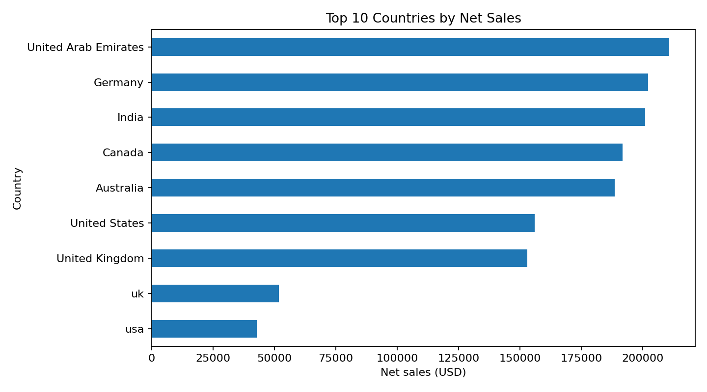

# SWYNEX Internship — Task 2: Exploratory Data Analysis

**Dataset:** `ecommerce_retail_transactions_cleaned.csv`  
**Analysis date:** 12 October 2026  
**Tools:** Python, pandas, matplotlib

## 1. Objective
Explore the cleaned e-commerce transaction dataset, summarize its main characteristics, identify patterns, and translate the findings into business-relevant insights.

## 2. Dataset overview
- **Rows:** 11,814
- **Columns:** 13
- **Unique order IDs:** 11,814
- **Unique customers:** 3,368
- **Date range:** 2024-01-01 to 2026-06-30
- **Product categories:** 8
- **Countries:** 9

## 3. Metric definitions and assumptions
- **Gross sales (estimated):** quantity × unit price.
- **Discount amount (estimated):** gross sales × discount percentage / 100.
- **Net sales (estimated):** gross sales − discount amount.

These are estimates based on available columns. They exclude tax, shipping, returns, and other adjustments unless already incorporated into the source fields. Each row is treated as one transaction record. Confirm the dataset's business definitions before interpreting these values as accounting revenue.

## 4. Descriptive statistics
| Metric | Value |
|---|---:|
| Quantity per transaction — mean | 2.06 |
| Unit price — mean | $61.54 |
| Unit price — median | $42.80 |
| Discount — mean | 6.87% |
| Gross sales (estimated) | $1,500,541.86 |
| Discounts (estimated) | $102,514.78 |
| Net sales (estimated) | $1,398,027.08 |
| Average estimated net sales per row | $118.34 |
| Mean rating among rated records | 3.90/5 |
| Rated records | 5,846 of 11,814 |

## 5. Visual analysis

### Net sales by category

### Monthly net sales trend

### Payment method usage

### Order status distribution

### Customer ratings

### Top countries by net sales

## 6. Key insights and recommendations
1. **Category contribution:** Electronics is the highest net-sales category at $377,574.65, representing 27.0% of total estimated net sales. Consider checking stock availability and product-level margins in this category.\n2. **Payment preference:** Cash on Delivery is the most frequently used payment method, accounting for 17.3% of transactions (2,041 transactions). This suggests it is important to keep this payment flow reliable.\n3. **Order fulfilment mix:** Delivered is the most common recorded order status (6,472 transactions; 54.8%). Status is a snapshot in this dataset, so this distribution should not be interpreted as a delivery success rate without knowing how statuses were captured.\n4. **Geographic concentration:** United Arab Emirates contributes the most estimated net sales at $210,840.68 (15.1% of net sales). This market may merit a deeper look at category mix and fulfilment performance.\n5. **Product-level performance:** Power Bank ranks first by estimated net sales at $54,482.82 (3.9% of net sales). Compare its units and discount levels before making pricing or inventory decisions.\n6. **Rating coverage limitation:** Customer ratings are missing for 5,968 transactions (50.5%). The mean rating among the 5,846 rated transactions is 3.90/5; improve rating collection before using ratings as a complete customer-satisfaction measure.\n7. **Location data limitation:** Shipping city is missing for 491 transactions (4.2%). City rankings therefore describe only records with a populated city; country-level analysis can still use all records.\n8. **Discount impact:** Recorded discounts total an estimated $102,514.78, which is 6.8% of gross sales. Evaluate whether discounted products or categories also show stronger units or customer ratings before changing discount policy.\n
## 7. Data limitations
- **Missing customer ratings:** 5,968 rows (50.5%). Do not impute missing ratings as zero or treat them as dissatisfaction.
- **Missing shipping city:** 491 rows (4.2%). City comparisons use only records with a known city.
- **Status interpretation:** Order status counts are descriptive. Without status event history, they do not establish a delivery success rate or time-to-delivery.
- **Sales interpretation:** Estimated sales use quantity, unit price, and discount only; currency is assumed to be USD because the column is named `unit_price_usd`.
- **Time series:** The dataset covers 2024-01-01 to 2026-06-30. Incomplete first/last months can distort month-to-month comparisons.
- **Association versus causation:** These descriptive patterns do not prove that a payment method, discount, or category causes a particular outcome.

## 8. Conclusion
The EDA provides an overview of transaction activity, estimated sales, category and geographic mix, payment preferences, order statuses, and customer rating coverage. The strongest follow-up opportunities are to investigate the leading sales category and market, assess discount effectiveness using margin data if available, improve rating and city-field completeness, and analyze fulfilment outcomes with time-stamped status history.

## Files
- `SWYNEX_Task_2_EDA.ipynb`: reproducible notebook.
- `insights.md`: standalone insight list.
- `descriptive_statistics.csv`, `category_summary.csv`, `payment_method_summary.csv`, `order_status_summary.csv`, `monthly_sales_summary.csv`, `country_summary.csv`, `product_summary.csv`, `city_summary.csv`: exported tables.
- `charts/`: chart images used in this report.
